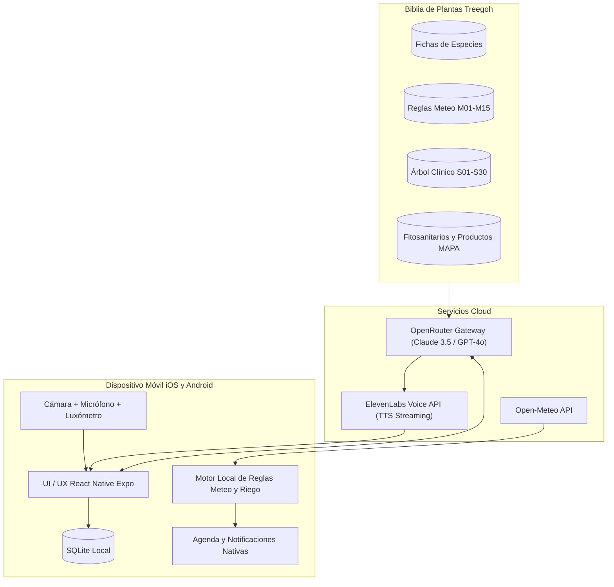
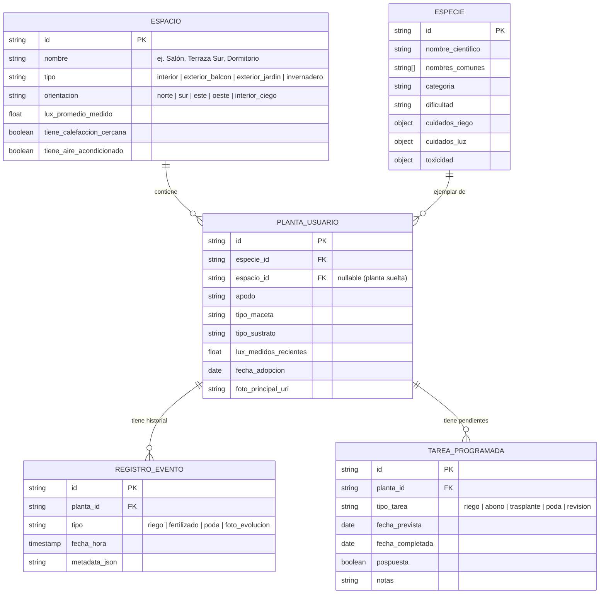

# Treegoh · Documento de Alcance Funcional, Arquitectura y Flujos de Usuario

**Versión:** 1.0.0  
**Fecha:** 2026-10-21  
**Plataforma:** Móvil nativa exclusiva (iOS y Android)  
**Principio rector:** *Primum non nocere* (Primero, no matar la planta; ante la duda, la acción menos irreversible y basada en evidencia).

---

## 1. Visión del Producto y Propuesta de Valor

Treegoh es un ecosistema móvil de cuidado inteligente de plantas domésticas que combina:
1. Una **base de conocimiento botánico y normativo rigurosa** (la "Biblia de Plantas"), contrastada con fuentes académicas (UC IPM, RHS, Clemson, etc.) y la legislación fitosanitaria española/UE (RD 1311/2012, MAPA).
2. Un **asistente multimodal por voz y visión** impulsado por **OpenRouter** (modelos de lenguaje y visión) y **ElevenLabs** (voces empáticas, fluidas y de baja latencia).
3. Una **integración profunda con el hardware móvil**: cámara (identificación y salud foliar), sensor de luz ambiental/cámara (luxómetro para la escala C1), micrófono/altavoz (conversación manos libres durante la jardinería), agenda/recordatorios del sistema y geoclima en tiempo real (temperatura, humedad exterior/interior estimada y déficit de presión de vapor).

---

## 2. Pila Tecnológica Central (Mobile-First)

### 2.1. Aplicación Móvil
* **Framework:** React Native con Expo (SDK New Architecture / Bridgeless).
* **Acceso Nativo:**
  * **Cámara:** `react-native-vision-camera` / `expo-camera` para captura fotográfica guiada de alta fidelidad.
  * **Audio y Voz:**
    * Captura de audio: `expo-av` con procesamiento streaming.
    * Reconocimiento de voz (STT): Whisper API vía OpenRouter o Speech nativo del SO.
    * Síntesis de voz (TTS): **ElevenLabs Conversational AI / Streaming Audio API** para respuestas por voz ultra-naturales.
  * **Sensores de Iluminación:**
    * Android: `Sensor.TYPE_LIGHT` (lectura directa en lux).
    * iOS: Módulo de fotometría mediante análisis de exposición de cámara (histograma + ISO + tiempo de exposición + EV a Lux).
  * **Agenda y Notificaciones:**
    * `expo-notifications` para notificaciones locales interactivas (posponer, confirmar riego, alerta meteorológica urgente).
    * `expo-calendar` para sincronización bidireccional con Apple Calendar y Google Calendar.
  * **Geolocalización y Clima:**
    * `expo-location` para ubicación del usuario.
    * Conexión directa a **Open-Meteo API** (previsión horaria, radiación, HR, VPD) y reglas climáticas locales.

### 2.2. Capa de Inteligencia Artificial, Búsqueda y Datos
* **Motor de Búsqueda y RAG:** **Typesense Cloud / Cluster**
  * Indexación en memoria (< 50 ms) de la "Biblia de Plantas" (fichas botánicas, diagnóstico, productos fitosanitarios no profesionales MAPA).
  * Tolerancia tipográfica botánica (resuelve errores al teclear nombres científicos/comunes como *dieffembachia*, *potos*, *ficus lirata*).
  * Búsqueda híbrida (léxica + embeddings vectoriales) y filtros multifaceta (luz, riego, toxicidad para mascotas, dificultad).
  * Reduce el consumo de tokens en OpenRouter al preseleccionar únicamente los fragmentos y reglas relevantes antes de consultar al LLM.
* **Gateway IA:** **OpenRouter** para orquestación de LLMs (p. ej., Claude 3.5 Sonnet / GPT-4o-mini para visión y razonamiento botánico mediante Function Calling conectado a Typesense).
* **Motor de Voz:** **ElevenLabs** (voces empáticas y fluidas mediante Conversational AI / Streaming Audio API).
* **Motor Determinista (Edge Rules Engine):** Ejecución local en el móvil de `reglas-meteo.json` y matrices de cálculo fenológico.
* **Persistencia Local (Offline-first):** SQLite local (`expo-sqlite` + Drizzle ORM) para el jardín privado del usuario, alarmas y configuraciones offline.

---

## 2.3. Estrategia de Gestión de Imágenes, Almacenamiento y Control de Tokens

Dado que una app de cuidado vegetal implica un flujo continuo de fotografías (identificación, consultas de hojas, seguimiento temporal), se establece un protocolo estricto de optimización:

### 1. Preprocesamiento en el Dispositivo (On-Device Client Pipeline)
* **Compresión y reescalado antes de subir:** La cámara móvil toma fotos a 12-48 MP (5-15 MB). Enviar eso a la nube o a un LLM es prohibitivo. La app ejecuta en local:
  * Redimensionamiento a máximo **1024x1024 px** (o 1280x720 px), suficiente para diagnóstico botánico y lectura de plagas.
  * Conversión a formato **WebP** con calidad al 80%.
  * **Resultado:** Reducción del tamaño de ~8 MB a **80 - 150 KB por imagen** (reducción del 98% en ancho de banda y almacenamiento).

### 2. Control de Consumo de Tokens de Visión (OpenRouter)
* Los modelos de visión modernos (ej. GPT-4o-mini / Claude 3.5 Haiku / Sonnet) tarifan las imágenes en mosaicos de tiles de 512x512 px (~85-170 tokens por tile).
* Una imagen preprocesada a 1024x1024 px consume únicamente **~250-700 tokens de entrada** (~$0.0003 a $0.001 USD por consulta visual).
* **Estrategia en dos pasos:**
  1. *Filtro local previo:* El usuario encuadra con guías visuales (evita enviar fotos desenfocadas o sin planta que malgasten tokens).
  2. *Modelo ligero primero:* Para identificación de especie o triaje rápido se usa un modelo ultra-rápido/económico (ej. `gpt-4o-mini` o `gemini-1.5-flash` vía OpenRouter); solo si hay sospecha de patología compleja o ambigüedad clínica se escala a `claude-3.5-sonnet`.

### 3. Almacenamiento y Ciclo de Vida de las Fotos (Storage Tiering)
* **Fotos de Perfil y Evolución de Plantas (Persistentes):**
  * Almacenadas en **Cloudflare R2** o **Supabase Storage** (R2 no cobra por egress/descargas y ofrece 10 GB gratuitos; luego $0.015/GB/mes).
  * Almacenar 100.000 fotos comprimidas en WebP ocupa ~12 GB (~$0.18 USD/mes). El almacenamiento no es un problema de costes.
* **Fotos de Consultas Efímeras del Asistente:**
  * Las fotos de preguntas casuales ("¿esto es un bicho?") se almacenan con política de ciclo de vida (TTL): expiran y se eliminan a los **30-90 días**, a menos que el usuario las guarde expresamente en el historial clínico de la planta.
* **Caché Local:** Miniaturas cacheadas en el almacenamiento privado del dispositivo con `expo-file-system`.

---

## 3. Módulos Funcionales

### Módulo 1: Onboarding y Diagnóstico Inicial de Espacio
* Detección de zona bioclimática mediante GPS (ej. zona mediterránea, interior seco como Madrid con su dureza de agua característica).
* **Definición de Espacios del Hogar (Microclimas):** Configuración de estancias principales (ej. Salón, Terraza/Balcón, Dormitorio, Cocina, Baño) o modo rápido de "Plantas sin asignar / Sueltas".
* Evaluación lumínica preliminar de las estancias mediante el luxómetro integrado y registro de orientación (Norte, Sur, Este, Oeste).

### Módulo 2: Registro, Identificación y Agrupación por Espacios (Mi Jardín)
* **Identificación por Imagen:** Captura guiada (hoja completa + detalle de nerviación/tallo) enviada vía OpenRouter Vision. Cotejo con la lista maestra de especies.
* **Asignación a Espacio / Microclima:**
  * La planta puede vivir dentro de un **Espacio** (ej. *Balcón Sur*, *Salón luminoso*, *Baño húmedo*) o mantenerse como **Planta individual/suelta**.
  * **Agrupación Inteligente de Cuidados:** Las plantas en un mismo espacio comparten condiciones ambientales (VPD, temperatura, riesgo de corrientes o sol directo). Si una ola de calor afecta al *Balcón*, la alerta aplica en lote a todas las plantas de ese espacio.
  * **Sinergias botánicas por microclima:** Detección de beneficios de agrupación (ej. agrupar Calatheas y Helechos en el baño o rincón húmedo para elevar la humedad relativa local por transpiración).
* **Ficha de Adopción:**
  * Especie detectada y nombre asignado por el usuario.
  * Espacio vinculado (o "Sin espacio asignado").
  * Ubicación específica en la estancia (distancia a ventana, radiador o corriente de aire).
  * Tipo de maceta (barro, plástico, autorriego, con o sin drenaje).
  * Tipo de sustrato (universal, aráceas/orquídeas, suculentas, perlita/fibra de coco).
  * Nivel de toxicidad en el hogar (alerta mascotas/niños según ASPCA).

### Módulo 3: Motor Dinámico de Riego y Fenología Climática
* **No a los riegos por días fijos:** El intervalo se calcula dinámicamente:
  `Frecuencia Base (Ficha) * Factor Clima (Meteo) * Factor Maceta/Sustrato * Factor Estación`
* **Ajuste Meteo en Tiempo Real (Reglas M01-M15):**
  * Olas de calor (>= 30°C / >= 35°C): alerta preventiva de revisión de sustrato matutino y sombreo.
  * Humedad extrema o lluvias continuadas: freno de riegos y alerta de hongos/pudrición.
  * Calefacción en invierno (sequedad ambiental): recomendación de humidificador y distancia de radiadores (evitando el mito inútil de pulverizar hojas).

### Módulo 4: Luxómetro y Gestión de Luminosidad (Escala C1)
* Calibrador interactivo en tiempo real con indicador dinámico:
  * Sombra / Luz baja: < 500 lux (< 50 fc)
  * Luz media indirecta: 500 - 1.500 lux (50 - 150 fc)
  * Luz brillante indirecta: 1.500 - 5.000 lux (150 - 500 fc)
  * Sol directo suave: 5.000 - 10.000 lux (500 - 1.000 fc)
  * Sol directo intenso: > 10.000 lux (> 1.000 fc)
* Comprobación instantánea: "¿Es este rincón apto para mi Ficus lyrata?"

### Módulo 5: Asistente Botánico Multimodal (Voz ElevenLabs + OpenRouter)
* **Modo Manos Libres (Voice-First):** Diseñado para cuando el usuario tiene las manos ocupadas durante el trasplante o la poda.
* **Auditoría de Salud por Foto (Diagnóstico Clínico):**
  * Protocolo fotográfico en 3 tomas: plano general de la planta, anverso de la hoja afectada, envés y cuello de la raíz.
  * Detección de plagas (araña roja, cochinilla, trips, mosca blanca) y enfermedades (oídio, botritis, pudrición por Pythium/Phytophthora).
* **Prescripción Segura y Legal de Productos:**
  * Solo productos autorizados para uso no profesional / doméstico en España (RD 1311/2012, MAPA).
  * Desmitificación activa: prohibición de recomendar aceite de neem en aerosol no registrado, alcohol directo no formulado o agua reposada para evaporar cloramina.

### Módulo 6: Agenda, Recordatorios y Tareas de Mantenimiento
* **Timeline de Tareas:**
  * Riego (con confirmación de "Comprobé el sustrato a 3 cm y estaba seco").
  * Fertilización (ajustada al ciclo vegetativo y descanso invernal).
  * Poda de limpieza vs. poda formativa.
  * Trasplante y renovación de sustrato (en primavera/crecimiento activo).
  * Limpieza de polvo foliar con paño húmedo para optimizar la fotosíntesis.
* **Integración:** Notificación push local actionable y opción de sincronizar con el calendario nativo del teléfono.

---

## 4. Diagrama de Arquitectura del Sistema

---

## 5. Flujos de Uso Principales (User Journeys)

### Flujo 1: Registro de una Nueva Planta y Calibración del Lugar
1. El usuario abre la app y pulsa en **"Añadir Planta"**.
2. La cámara se abre con una retícula de encuadre. El usuario toma una foto de la planta completa y una de las hojas.
3. **OpenRouter Vision** analiza la imagen, devuelve la especie probable (ej. *Monstera deliciosa*) y su grado de certeza.
4. El usuario confirma o busca la especie en la base de datos local.
5. La app solicita evaluar el lugar: el usuario enfoca la zona donde vivirá la planta y el **luxómetro** mide la luz en tiempo real.
6. La app compara la luz medida con los requerimientos óptimos de la ficha y emite un veredicto: *"Luz brillante indirecta (~2.100 lux). Rincón ideal para tu Monstera"*.
7. El usuario indica tipo de maceta y sustrato. Se genera el primer plan fenológico y de riego.

### Flujo 2: Consulta Asistida por Voz ("Modo Jardinería")
1. El usuario activa el asistente por voz (botón flotante o manos libres).
2. Pregunta: *"Oye Treegoh, ¿es momento de abonar mi Pothos hoy?"*
3. El micrófono graba el audio y se transcribe (STT).
4. El motor consulta la fecha, la estación climática actual, la última fecha de fertilización registrada en SQLite y las reglas de abonado de *Epipremnum aureum*.
5. Si estamos en noviembre/invierno o se abonó hace 10 días, el sistema genera la respuesta fundamentada.
6. **ElevenLabs** genera la respuesta por voz con entonación natural: *"Aún no. Tu Pothos está en su periodo de descanso vegetativo y lo fertilizaste hace dos semanas. Espera hasta la primavera para no quemar sus raíces."*

### Flujo 3: Diagnóstico de Síntoma Foliar y Tratamiento
1. El usuario nota puntas marrones o manchas amarillas en las hojas. Pulsa en **"Diagnosticar"**.
2. La app solicita 3 fotos obligatorias para evitar falsos positivos:
   - Vista general.
   - Detalle de la mancha/hoja.
   - Envés de la hoja o sustrato.
3. El sistema coteja los síntomas visuales contra el árbol clínico (S01–S30):
   - ¿Hay telaraña fina? -> Ácaros / Araña roja.
   - ¿Halo clorótico translúcido? -> Mancha bacteriana / fúngica por exceso de humedad.
4. Si detecta plaga, el asistente recomienda exclusivamente productos del catálogo de uso doméstico autorizado (ej. Jabón potásico formulado no profesional, aislamiento de la planta, cuarentena de 4 a 6 semanas).
5. Se programa automáticamente una tarea de revisión a los 7 días en la agenda.

### Flujo 4: Adaptación Meteorológica Automática (Día de Ola de Calor)
1. El servicio en segundo plano consulta la previsión meteorológica de la zona vía Open-Meteo.
2. Se detecta una máxima de 36°C con humedad relativa del 18% (Disparo de Regla **M02**).
3. La app envía una notificación actionable antes de las 9:00 AM:
   > ⚠️ *Ola de calor hoy (36°C).*  
   > *Tus plantas en el balcón necesitarán revisión de sustrato hoy y protección contra el sol directo de mediodía.*
4. Al pulsar la notificación, se abre una lista de comprobación de 3 pasos (comprobar humedad con el dedo, retrasar fertilizantes, meter macetas frágiles si el balcón no tiene toldo).

---

## 6. Esquema de Entidades de Datos Clave (Data Model)

---

## 7. Catálogo de Tweaks e Integraciones Nativas iOS (Experiencia Premium)

Para que Treegoh se sienta como una aplicación desarrollada por Apple (*craftmanship* de primer nivel), planificamos los siguientes detalles de interacción e integraciones del sistema operativo:

### 7.1. Microinteracciones Hápticas (CoreHaptics / UIImpactFeedbackGenerator)
* **Luxómetro Dinámico:** Feedback háptico variable a medida que el sensor detecta más o menos luz. Al entrar en el rango óptimo ("Luz brillante indirecta"), el dispositivo emite un chasquido sutil de confirmación (`impactOccurred(intensity: 1.0)` o `.medium`).
* **Check de Riego / Tarea:** Pulsación profunda al marcar una planta como regada (`UINotificationFeedbackGenerator(.success)`).
* **Alertas Clínicas:** Patrón de doble pulso suave si la foto revela sospecha de plaga o riesgo inminente de pudrición de raíz.

### 7.2. Widgets de Pantalla de Inicio y Bloqueo (WidgetKit)
* **Widget Pequeño (1x1):** Indicador de la planta más urgente (*"Monstera: Riego sugerido hoy (sustrato seco)"*).
* **Widget Mediano (2x2):** Estado del jardín con barra de tareas del día e indicador del tiempo/VPD exterior.
* **Lock Screen & StandBy Mode:** Indicador monocromo de humedad y botón directo para activar el luxómetro o el asistente de voz.

### 7.3. Dynamic Island & Live Activities (Actividades en Vivo)
* **Modo Jardinería / Riego en Vivo:** Cuando el usuario empieza a regar o trasplantar, la Dynamic Island muestra el progreso de plantas atendidas (ej. *3 de 7 regadas*).
* **Streaming de Voz de ElevenLabs:** Visualización animada de forma de onda (*waveform*) en la Dynamic Island mientras el asistente botánico está respondiendo verbalmente.

### 7.4. Atajos de Siri y App Intents
* Integración nativa con **App Intents**:
  * *"Oye Siri, ¿cuándo le toca agua a mi Ficus?"*
  * *"Oye Siri, anota que regué el Pothos."*
  * Activación inmediata sin necesidad de abrir la aplicación completa.

### 7.5. Acciones Rápidas (3D Touch / Quick Actions desde el Icono)
* Pulsación larga en el icono de la app en la pantalla de inicio:
  1. 📷 *Diagnosticar Hoja* (abre la cámara directamente en modo macro).
  2. 💡 *Medir Luz del Rincón* (abre directamente el luxómetro).
  3. 🎙️ *Consultar Asistente* (abre el canal de voz directo de ElevenLabs).
  4. 🪴 *Añadir Planta*.

### 7.6. Notificaciones Actionable y Rich Push
* Notificaciones con vista previa en miniatura de la planta afectada.
* Botones de acción directa dentro de la notificación (sin abrir la app):
  * `[ Ya la regué ]` -> Registra el evento en SQLite en segundo plano.
  * `[ Posponer 1 día ]` -> Aplaza el cálculo meteo.
  * `[ Consultar Asistente ]` -> Despliega la interfaz de voz.

### 7.7. Gestos Fluidos y Navegación "iOS-First"
* **Deslizar para completar:** Swipe lateral con animación elástica y desvanecimiento de tarjeta al tachar un riego.
* **Hojas modales nativas (Detent Sheets):** Modales con arrastre de altura variable (50% para ver la ficha rápida, 90% para el historial completo) usando soporte nativo de iOS.
* **Modo Oscuro Dinámico:** Adaptación a la paleta de branding con fondo `#2F3E46` y contraste automático con el modo del sistema.
* **Spatial Audio / Ambient Soundscapes:** Efectos sonoros sutiles y orgánicos (sonido de gota de agua amortiguada al registrar riego) diseñados para no ser intrusivos.

### 7.8. Cámara Contextual Integrada ("In-App Viewfinder Sheet" · Patrón ChatGPT)
* **Continuidad de contexto (Zero-Disruption UX):** En lugar de cambiar de pantalla o abrir el selector modal estándar del sistema que expulsa al usuario de su flujo, la cámara se despliega como una **hoja emergente contextual (Bottom Sheet)** desde la parte inferior, ocupando entre el 60% y el 80% de la pantalla.
* **Interacción interactiva y multitarea:**
  * El usuario sigue viendo el chat con el asistente, la ficha de la planta o el luxómetro en la parte superior/fondo difuminado mientras apunta la cámara.
  * Botón de disparo con respuesta háptica instantánea (`UIImpactFeedbackGenerator(.rigid)`).
  * Al capturar, la foto se acopla como una miniatura animada directamente en el campo de texto o en el prompt del asistente, manteniendo el teclado o el micro abierto sin perder la conversación.
  * Posibilidad de arrastrar la hoja hacia abajo para descartar con inercia elástica natural de iOS.

